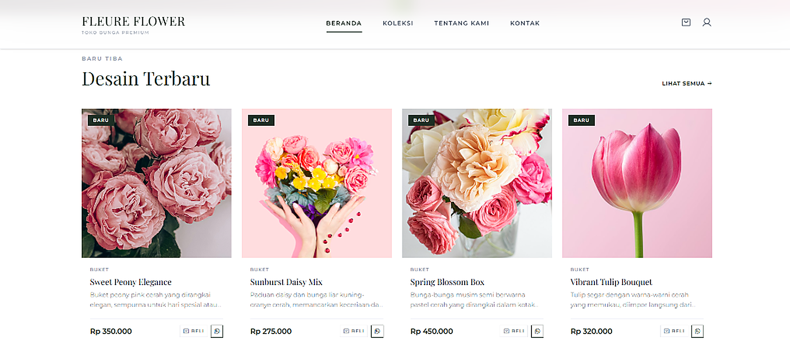
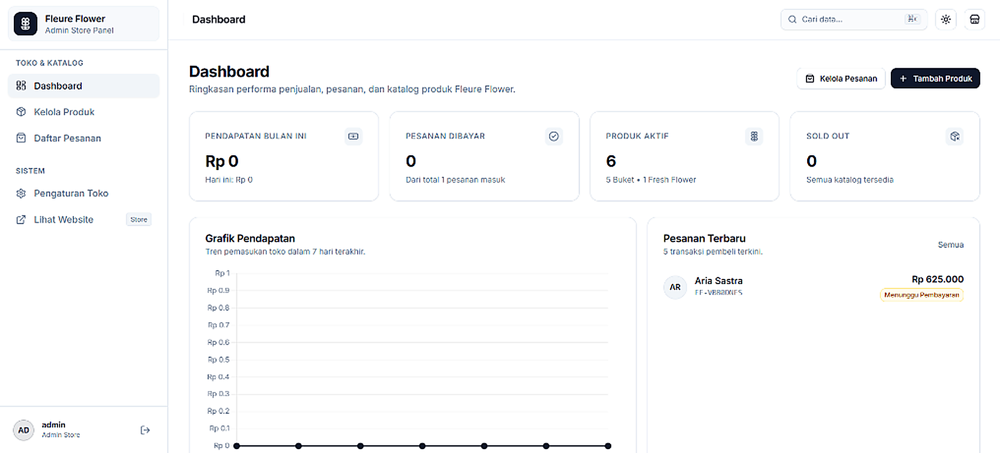

# 🌸 Fleure Flower - Premium Florist E-Commerce


**Fleure Flower** is a luxury boutique florist e-commerce web application engineered with **Laravel 13** and **Tailwind CSS v4**. It delivers an elegant, responsive, and secure floral shopping experience (featuring bespoke bouquets, fresh floral arrangements, and greeting cards), accompanied by an **Administrative Management Suite** inspired by the **Shadcn Admin Design System** with complete Light, Dark, and System theme support.

---

## 📸 High-Definition Application Preview

<p align="center">
  <b>Storefront Landing Page</b><br>
  
</p>

<p align="center">
  <b>Store Administrative Dashboard (Shadcn-Admin Style)</b><br>
  
</p>

---

## ✨ Key Features

### 🛒 Customer-Facing Storefront
- **Modern Authentication:** Seamless registration and credential login alongside one-click **Google OAuth 2.0** authentication via Laravel Socialite.
- **Profile Management:** Users can customize display names (with a 24-hour rate limit), profile bios, and select custom avatars from an integrated icon library or sync their Google avatar.
- **Interactive Catalog:** Filter floral collections smoothly across categories (*Bouquets, Fresh Flowers, Greeting Cards*).
- **Session Shopping Cart:** Persistent session-based shopping cart for effortless checkout workflows.
- **Midtrans Payment Integration:** Real-time processing supporting GoPay, QRIS, Bank Virtual Accounts, and Credit Cards via the **Midtrans Snap API**.

### 📊 Administrative Suite (Shadcn Admin UI)
- **Shadcn Design System & Dark Mode:** Pristine Slate OKLCH color palette, 0.625rem radius, 16rem collapsible sidebar, sticky blurred header, and a **3-Way Theme Toggle** (Light, Dark, System) with anti-FOUC prevention.
- **Executive Analytics Dashboard:** 4 KPI summary cards with percentage trend indicators, latest order tables, and an auto-adjusting **7-Day Revenue Trend Chart** (Chart.js) responding instantly to theme switches.
- **Catalog Management (CRUD):** Add, update, delete, and toggle product statuses (Available / Sold Out) with dropzone file uploads and live image previews.
- **Order Management:** Real-time tracking of order streams, Midtrans payment verification, and delivery progression.
- **Atelier Settings:** Customize atelier name, physical location, WhatsApp contact, and working hours.
- **Command Palette (`⌘K` / `Ctrl+K`):** Rapid keyboard-driven navigation across admin modules.

### 🛡️ Security & Engineering Standards
- **Admin Route Obfuscation:** The administration URL avoids predictable routes (`/admin`) and is dynamically driven by `ADMIN_PREFIX` in `.env` (default: `fleure-portal-mgmt`). Legacy endpoints (`/admin`, `/admin/login`) return **HTTP 404 Not Found** to thwart automated bot crawlers.
- **Brute-Force Rate Limiting:** Enforces strict login attempt thresholds on customer and administrative login throttles.
- **Pessimistic Locking:** Leverages `DB::transaction()` and `lockForUpdate()` on Midtrans webhooks to prevent race conditions and duplicate processing.
- **XSS & CSRF Immunity:** Forms are protected with `@csrf` tokens; inputs are sanitized to strip malicious script payloads.
- **Graceful Error Recovery:** Resilient try-catch boundaries on external API calls ensuring third-party gateway hiccups do not break user flows.
- **Strict Unique Invoice Generation:** Deterministic and unique invoice ID sequence generation.

---

## 🚀 Local Installation & Setup Guide

### 1. Repository Cloning
```bash
git clone https://github.com/pranataa-labs/Fleure-Flower.git
cd Fleure-Flower
```

### 2. Dependency Installation
```bash
composer install
npm install
```

### 3. Environment Setup
```bash
cp .env.example .env
php artisan key:generate
```
Configure your `.env` parameters:
```env
DB_CONNECTION=mysql
DB_HOST=127.0.0.1
DB_PORT=3306
DB_DATABASE=fleure_flower
DB_USERNAME=root
DB_PASSWORD=
ADMIN_PREFIX=fleure-portal-mgmt
MIDTRANS_SERVER_KEY=your-midtrans-server-key
MIDTRANS_CLIENT_KEY=your-midtrans-client-key
MIDTRANS_IS_PRODUCTION=false
```

### 4. Database Migration & Seeding
```bash
php artisan migrate --seed
```

### 5. Symbolic Storage Link
```bash
php artisan storage:link
```

### 6. Asset Compilation & Development Server
```bash
npm run build
php artisan serve
```
- Storefront: `http://localhost:8000`
- Administrative Portal: `http://localhost:8000/login`

---

## 🔐 Default Admin Credentials

- **Username:** `admin`
- **Password:** `admin123`
